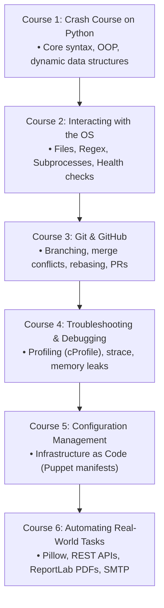

# 🐍 Google IT Automation with Python Study Hub & Code Repository

<div align="center">

### **🏆 Official 6-Course Specialization — 100% Grade Perfection**

[](https://www.coursera.org/account/accomplishments/specialization/H6GAQJMR8OH4)
[](https://python.org)
[](https://git-scm.com)
[](https://puppet.com/)

**Learner:** Eng. Ahmed Rifai  
**License:** Kiron Open Higher Education Coursera License  
**Comprehensive Study Guide:** [📖 Read the Complete IT Automation Study Guide](STUDY_GUIDE.md)

</div>

---

## 📌 Repository Overview

This repository serves as an operational study hub, automation reference, and script repository for the **Google IT Automation with Python Professional Certificate**. It documents production automation workflows across Python system scripting, Linux OS management, Git version control, systematic performance troubleshooting, Puppet infrastructure as code, and automated multi-service pipelines (REST APIs, Pillow image processing, ReportLab dynamic PDFs, SMTP email dispatch).

> [!NOTE]
> All binary credential certificates and verification proofs are officially archived in Google Drive and verified via official Coursera credential IDs. This repository focuses strictly on high-yield technical artifacts: structured coursework, reusable automation scripts, and study guides.

---

## 🏗️ IT Automation Workflow Blueprint



---

## 📚 Curriculum & Course Breakdown

| # | Course Title | Score | Focus Areas | Official Verification |
|:---:|:---|:---:|:---|:---:|
| **01** | Crash Course on Python | **100%** | Data structures, recursion, OOP, custom string methods | [KJOENEZZ0HMI](https://www.coursera.org/account/accomplishments/verify/KJOENEZZ0HMI) |
| **02** | Using Python to Interact with the Operating System | **100%** | Files, regex, subprocesses, log parsing, unit testing | [CWJGI2J07DJT](https://www.coursera.org/account/accomplishments/verify/CWJGI2J07DJT) |
| **03** | Introduction to Git and GitHub | **100%** | Three-tree architecture, branches, conflict resolution, remotes | [0XNUFOI74SYI](https://www.coursera.org/account/accomplishments/verify/0XNUFOI74SYI) |
| **04** | Troubleshooting and Debugging Techniques | **95%** | Systematic debugging, binary search, profiling, concurrency | [RKIVEJ2J7H2L](https://www.coursera.org/account/accomplishments/verify/RKIVEJ2J7H2L) |
| **05** | Configuration Management and the Cloud | **100%** | Declarative IaC, Puppet architecture, cloud auto-scaling | [R8ALWTT131BJ](https://www.coursera.org/account/accomplishments/verify/R8ALWTT131BJ) |
| **06** | Automating Real-World Tasks with Python | **100%** | Pillow batch imaging, REST endpoints, PDF generation, email | [OO5EXZ9ZSC7F](https://www.coursera.org/account/accomplishments/verify/OO5EXZ9ZSC7F) |
| 🎓 | **Full Professional Certificate Credential** | **100%** | **Google IT Automation with Python Master Credential** | [H6GAQJMR8OH4](https://www.coursera.org/account/accomplishments/specialization/H6GAQJMR8OH4) |

---

## 📂 Repository Structure

```text
├── STUDY_GUIDE.md                     # Comprehensive theoretical & system automation study guide
├── README.md                          # Repository overview & verification index
├── .gitignore                         # Excludes cache & certificate binaries
├── 01-Crash-Course-on-Python/         # Python foundational scripts & OOP exercises
├── 02-Using-Python-to-Interact.../    # OS interaction, regex, subprocess & health checks
├── 03-Introduction-to-Git-and-GitHub/ # Version control labs & branching workflows
├── 04-Troubleshooting-and-Debugging/  # Performance profiling & debugging tools
├── 05-Configuration-Management.../    # Puppet manifests & cloud deployment playbooks
└── 06-Automating-Real-World-Tasks/    # Pillow imaging, REST endpoints, ReportLab PDFs & email
```

---

## 👤 Author
**Eng. Ahmed Rifai**  
*AI & Automation Engineer*  
GitHub: [@Eng-Ahmed-Rifai](https://github.com/Eng-Ahmed-Rifai)
