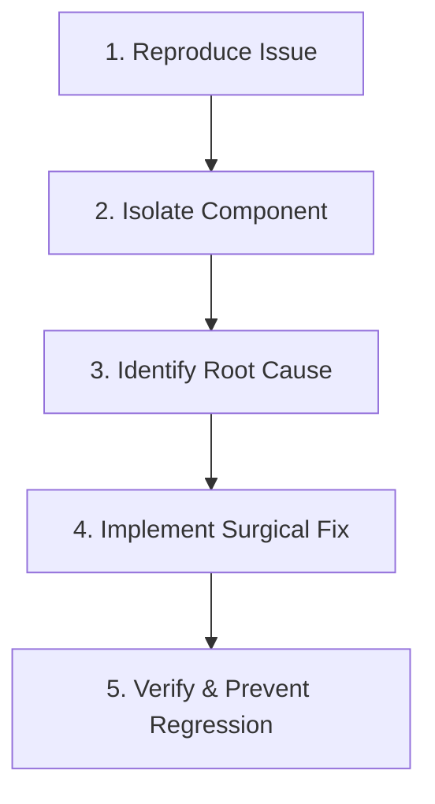

# 🐍 Google IT Automation with Python — Comprehensive Study Guide

**Author:** Eng. Ahmed Rifai  
**Credential:** [H6GAQJMR8OH4](https://www.coursera.org/account/accomplishments/specialization/H6GAQJMR8OH4) (Verified 100% Mastery across all 6 Courses)  
**Target:** System Automation, OS Interfacing, Git Operations, Troubleshooting & Debugging, Configuration Management (Puppet), and Cloud Workflow Orchestration.

---

## 📑 Table of Contents
1. [Course 1: Crash Course on Python](#course-1-crash-course-on-python)
2. [Course 2: Using Python to Interact with the Operating System](#course-2-using-python-to-interact-with-the-operating-system)
3. [Course 3: Introduction to Git and GitHub](#course-3-introduction-to-git-and-github)
4. [Course 4: Troubleshooting and Debugging Techniques](#course-4-troubleshooting-and-debugging-techniques)
5. [Course 5: Configuration Management and the Cloud](#course-5-configuration-management-and-the-cloud)
6. [Course 6: Automating Real-World Tasks with Python](#course-6-automating-real-world-tasks-with-python)

---

## Course 1: Crash Course on Python

### 1. Data Structures & Performance
- **Lists vs Tuples**: Lists are mutable (dynamic arrays, $O(1)$ append, $O(n)$ insert); Tuples are immutable and hashable.
- **Dictionaries**: Hash table implementation offering average $O(1)$ lookup, insertion, and deletion.
- **List Comprehensions**: Elegant syntax for mapping and filtering:
  ```python
  squared_evens = [x**2 for x in range(20) if x % 2 == 0]
  ```

### 2. Object-Oriented Programming (OOP)
- Class definitions, instance methods, inheritance, polymorphism, and dunder methods (`__init__`, `__str__`, `__repr__`, `__eq__`).

---

## Course 2: Interacting with the Operating System

### 1. File & Directory Operations
- Reading and writing files safely using context managers (`with open(...) as f:`).
- `os` and `pathlib` for cross-platform path handling (`os.path.join`, `os.walk`, `pathlib.Path`).
- File metadata inspection (`os.path.getsize`, `os.path.getmtime`).

### 2. Regular Expressions (`re`)
- Pattern matching: `^`, `$`, `\d+`, `\w+`, `[a-zA-Z0-9._%+-]+@[a-zA-Z0-9.-]+\.[a-zA-Z]{2,}`.
- Capturing groups: `re.search(r"(\w+), (\w+)", text)`.
- Substitution: `re.sub(r"(?i)old_domain\.com", "new_domain.org", email)`.

### 3. Subprocesses & System Health Checks
- Invoking external CLI utilities: `subprocess.run(["ping", "-c", "3", host], capture_output=True, text=True)`.
- Resource monitoring: Checking disk space with `shutil.disk_usage("/")` and CPU utilization with `psutil.cpu_percent()`.

---

## Course 3: Introduction to Git and GitHub

### 1. Version Control Architecture
- **Three Trees**: Working Directory $\to$ Staging Area (Index) $\to$ Local Repository (HEAD).
- Core Commands:
  - `git add -A`: Stages changes.
  - `git commit -m "msg"`: Creates snapshot.
  - `git log --graph --oneline --all`: Visualizes branch history.
  - `git revert <commit>`: Safe, non-destructive undo creating an inverse commit.

### 2. Branching & Merging
- Fast-forward vs Three-way merge.
- Resolving merge conflicts by editing conflict markers (`<<<<<<<`, `=======`, `>>>>>>>`).
- Rebasing (`git rebase main`): Rewrites branch commits on top of base for a clean, linear history.

---

## Course 4: Troubleshooting and Debugging Techniques

### 1. The Systematic Troubleshooting Workflow


### 2. Diagnostic Tooling & Profiling
- **Binary Search**: Bisecting faulty configurations or commits with `git bisect`.
- **System Call Tracing**: `strace` (Linux) or Process Monitor (Windows) to identify missing files or failed socket connections.
- **Profiling**: `cProfile` and `pstats` to identify runtime CPU bottlenecks; memory profilers to detect leaks.
- **Concurrency**: Avoiding race conditions and deadlocks via thread locking (`threading.Lock`) or leveraging multiprocessing.

---

## Course 5: Configuration Management and the Cloud

### 1. Infrastructure as Code (IaC) & Puppet
- **Declarative vs Imperative**: Declare *what* state the system should be in, rather than *how* to execute it step-by-step.
- **Puppet Architecture**:
  - Puppet Master & Puppet Agent.
  - Resources: `package`, `file`, `service`.
  ```puppet
  package { 'nginx':
    ensure => installed,
  }

  service { 'nginx':
    ensure  => running,
    enable  => true,
    require => Package['nginx'],
  }
  ```

### 2. Cloud Orchestration
- Scaling: Horizontal (adding instances) vs Vertical (increasing instance resources).
- Automated provisioning, health checks, self-healing deployments, and rollback strategies.

---

## Course 6: Automating Real-World Tasks with Python

### 1. Image Processing with Pillow
- Batch resizing, format conversion (e.g., TIFF to JPEG), rotating, and thumbnail generation using `PIL.Image`.

### 2. REST APIs & Web Scraping
- Interacting with JSON web services via `requests.get` and `requests.post` with error handling (`response.raise_for_status()`).

### 3. Automated PDF Reporting & Email Delivery
- Generating dynamic PDF summaries using `reportlab.platypus` (SimpleDocTemplate, Paragraph, Table).
- Formatting MIME emails with attachments using `email.message.EmailMessage` and delivering via secure SMTP (`smtplib.SMTP_SSL`).
